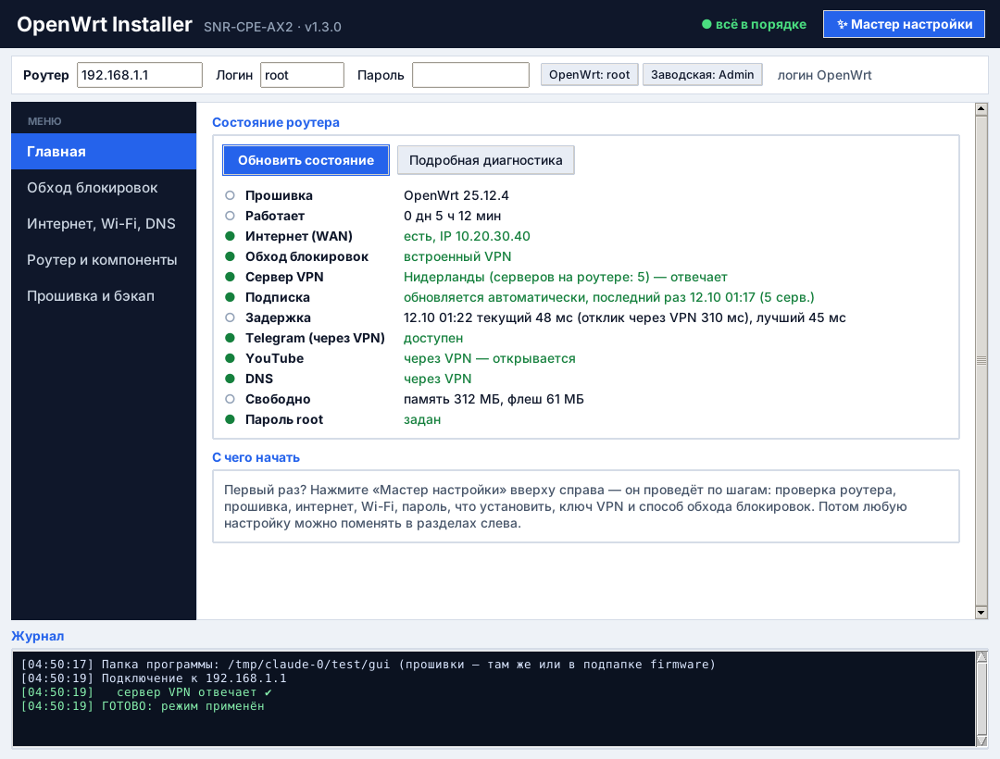
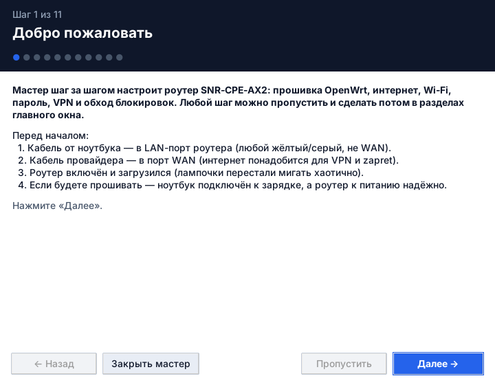
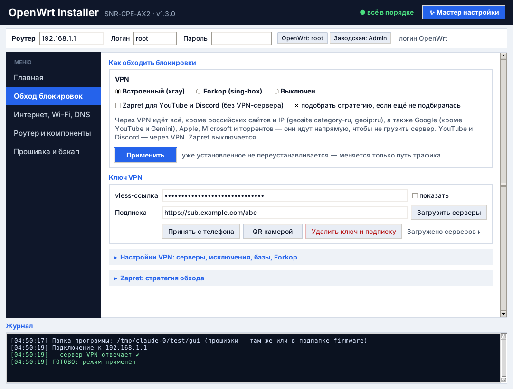
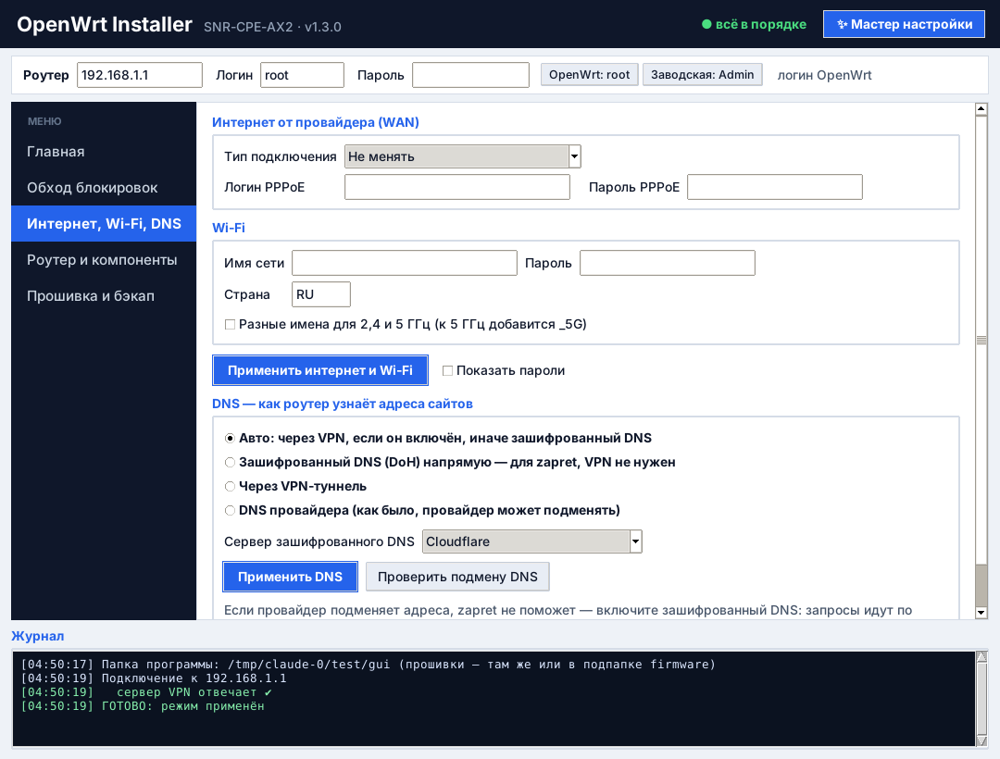

<p align="center"></p>

<h1 align="center">OpenWrt Installer SNR AX2</h1>

<p align="center">
Программа, которая сама прошивает роутер <b>SNR-CPE-AX2</b> на OpenWrt и превращает его в домашний роутер с VPN (xray / vless),  (zapret) и защищённым DNS — без командной строки и ковыряния в настройках OpenWrt.
<br><br>
Windows 7 / 10 / 11 · Linux · macOS · <a href="README.en.md">English</a>
</p>

<p align="center"></p>

> **Статус: бета.** Основной сценарий проверен на реальном роутере, часть функций — пока только на тестовом стенде. Нашли ошибку — откройте [Issue](../../issues) и приложите журнал из окна программы.
>
> **Некоммерческий проект с открытым исходным кодом (GPL-3.0).** Сделан для себя и друзей. Перепрошивка — всегда риск: читайте раздел [«Важно»](#важно) перед началом.

---

## Что умеет

**Прошивка**
- Ставит OpenWrt на SNR-CPE-AX2 с заводской прошивки полностью автоматически: загрузчик → recovery по TFTP (TFTP-сервер встроен) → основная прошивка.
- Делает **бэкап заводской прошивки** (все разделы, включая калибровку Wi-Fi) и умеет **возвращать заводскую прошивку** из бэкапа.
- **Мастер первой настройки** — проводит по шагам, любой шаг можно пропустить.

**Интернет и Wi-Fi**
- PPPoE / DHCP от провайдера, имя и пароль Wi-Fi (одна сеть на оба диапазона или раздельно), пароль root, русский язык в веб-панели.

**VPN (xray, vless)**
- vless-ссылка или **подписка** (Reality, TLS, WS, gRPC, XHTTP, HTTPUpgrade); приём ссылки **с телефона** через локальную страницу/QR и **сканирование QR камерой** ноутбука.
- Маршрутизация: напрямую — российские сайты и IP (`geosite:category-ru`, `geoip:ru`), Google (кроме YouTube и Gemini), Apple, Microsoft, торренты; всё остальное — через VPN. Свои исключения «всегда напрямую / всегда через VPN».
- **Роутер сам следит за VPN**: переключается на другой сервер, если текущий упал или стал медленным; сам обновляет подписку раз в 6 часов; раз в неделю обновляет geo-базы. Ненужные серверы можно **исключить**.

**Forkop (готовое решение на sing-box)**
- По желанию вместо встроенного VPN программа ставит [Forkop](https://github.com/ushan0v/forkop) в два клика и сама настраивает базовые разделы. Дальше — гибкие правила «какой сайт через какой сервер», ByeDPI, свои списки в его веб-панели.

**Zapret (обход DPI без VPN)**
- Установка с GitHub и **автоподбор стратегии** под провайдера (blockcheck + проверка на реальном трафике).
- Режим 3 «zapret + VPN»: YouTube и Discord идут через zapret, а если он перестал справляться — роутер сам временно пускает их через VPN.

**DNS**
- Провайдер не сможет подменять адреса: зашифрованный DNS (DoH: Cloudflare, Google, Quad9, AdGuard) или DNS через VPN-туннель. Проверка подмены одной кнопкой.

**Удобство**
- Страница «Главная» с цветными индикаторами состояния, подробная диагностика, светодиоды вкл/выкл, сброс OpenWrt, экспорт/импорт настроек. Поля запоминаются (на Windows пароли шифруются DPAPI).

| Мастер настройки | VPN | DNS |
|---|---|---|
|  |  |  |

## Панель управления — версия без прошивки


**OpenWrt Panel** — облегчённая версия той же программы: всё, кроме прошивки. VPN и подписки, Forkop, zapret, DNS, Wi-Fi, PPPoE, компоненты, состояние, мастер настройки. Не требует прав администратора и подходит для **любого роутера, на котором уже стоит OpenWrt** (от 256 МБ ОЗУ и 128 МБ флеш) — см. [список подходящих роутеров](docs/ROUTERS.md).

<br clear="left">

## Быстрый старт

1. Скачайте программу для своей системы со страницы **[последнего релиза](../../releases/latest)**:

   | Система | Файл |
   |---|---|
   | Windows 10 / 11 | `OpenWrtInstaller-Setup-…-windows-x64.exe` — установщик (ярлык в «Пуске» и на рабочем столе) или `OpenWrtInstaller-…-windows-x64.exe` — один файл без установки |
   | Windows 7 SP1 / 8 / 8.1 | `OpenWrtInstaller-Setup-…-windows7-x64.exe` или `OpenWrtInstaller-…-windows7-x64.exe` (без сканирования QR камерой) |
   | Linux x64 | `OpenWrtInstaller-…-linux-x64.tar.gz` |
   | macOS (Apple M1–M4) | `OpenWrtInstaller-…-macos-arm64.zip` (Mac на Intel — только запуск из исходников, см. ниже) |
   | Все файлы проекта одним архивом | `openwrt-installer-snr-ax2-…-all-files.zip` (исходники, прошивки, документация) |

   Прошивка OpenWrt **встроена в программу** — это один файл, ничего докачивать и распаковывать рядом не нужно, его можно просто переслать другу.
   Настройки, журналы и бэкапы программа хранит в своей папке данных (Windows: `%LOCALAPPDATA%\OpenWrtInstaller`), а не рядом с exe — так что его можно держать хоть на рабочем столе. Нужно всё рядом с программой (флешка) — положите возле неё пустой файл `portable.txt`.
   Для панели управления берите файлы `OpenWrtPanel-…` (без прошивки, права администратора не нужны).
2. Установите (Setup.exe) или просто положите exe куда удобно.
3. Соедините кабелем ноутбук и **LAN-порт** роутера. Кабель провайдера — в порт **WAN**.
4. Запустите программу:
   - **Windows** — двойной клик по `OpenWrtInstaller.exe` (попросит права администратора — это нужно для смены IP и TFTP). Если Защитник ругается — «Подробнее → Выполнить в любом случае» (программа не подписана сертификатом, это нормально для open source).
   - **Linux** — `sudo -E ./OpenWrtInstaller` (root нужен для прошивки; для настройки VPN/Wi-Fi можно без sudo).
   - **macOS** — правый клик по `OpenWrtInstaller.app` → «Открыть» (приложение не подписано). Если macOS пишет, что приложение «повреждено», выполните в Терминале `xattr -cr OpenWrtInstaller.app`. Для прошивки нужен root: `sudo OpenWrtInstaller.app/Contents/MacOS/OpenWrtInstaller`.
5. Откроется **мастер настройки** — идите по шагам.

Подробно — в [docs/INSTALL.md](docs/INSTALL.md), про каждый раздел — в [docs/USAGE.md](docs/USAGE.md).

## Установка через git clone (командная строка)

Нужны [Git](https://git-scm.com/downloads) и [Python 3.8+](https://www.python.org/downloads/) (на Windows при установке отметьте «Add python.exe to PATH»).

**Windows** (командная строка или PowerShell):
```bat
git clone https://github.com/igor-chelapin/panel-setup.git
cd panel-setup
run.bat
```

**Linux / macOS** (Терминал):
```bash
git clone https://github.com/igor-chelapin/panel-setup.git
cd panel-setup
./run.sh            # для прошивки роутера: sudo ./run.sh
```

Первый запуск сам создаст папку `.venv` и поставит зависимости, следующие запуски — сразу. Обновиться до свежей версии: `git pull` в той же папке. На Linux нужен tkinter: `sudo apt install python3-tk python3-venv` (Debian/Ubuntu).

Сборка своего exe/приложения — [docs/BUILD.md](docs/BUILD.md). Готовые сборки делает GitHub Actions при каждом теге `v*`.

## Как это устроено

Вся логика — один файл `openwrt_installer.py` (Python + tkinter). Программа управляет роутером по SSH и раскладывает на него небольшие скрипты: прозрачный прокси xray с правилами nftables, сторож (cron) для переключения серверов, автообновление подписки (ucode), управление DNS. Подробно — [docs/HOW_IT_WORKS.md](docs/HOW_IT_WORKS.md).

## Важно

- **Риск.** Перепрошивка может вывести роутер из строя, особенно при отключении питания во время записи загрузчика. Сначала сделайте бэкап (программа предложит). Авторы не несут ответственности — см. раздел «Disclaimer of Warranty» в [LICENSE](LICENSE).
- **Гарантия.** Установка OpenWrt обычно лишает заводской гарантии.
- **Законы.** Используйте программу в рамках законодательства своей страны. Проект — технический инструмент для настройки собственного оборудования; VPN-серверы и ключи в комплект не входят.
- **Только SNR-CPE-AX2.** Прошивка из папки `firmware` предназначена только для этой модели. Функции VPN/DNS/zapret должны работать и на других роутерах с OpenWrt 23.05+ (apk или opkg), но там не проверялись.

## Благодарности

[OpenWrt](https://openwrt.org) · [Xray-core](https://github.com/XTLS/Xray-core) · [zapret](https://github.com/bol-van/zapret) и [zapret-openwrt](https://github.com/remittor/zapret-openwrt) · [v2fly geoip / domain-list-community](https://github.com/v2fly) · [https-dns-proxy](https://github.com/aarond10/https_dns_proxy) · [paramiko](https://www.paramiko.org) · [segno](https://github.com/heuer/segno)

## Лицензия

[GNU GPL v3.0](LICENSE). Можно использовать, изучать, изменять и распространять; изменённые версии тоже должны оставаться открытыми под GPL-3.0. Прошивка в папке `firmware` — официальные образы OpenWrt (GPL-2.0, исходники: https://github.com/openwrt/openwrt), см. [firmware/README.md](firmware/README.md).
